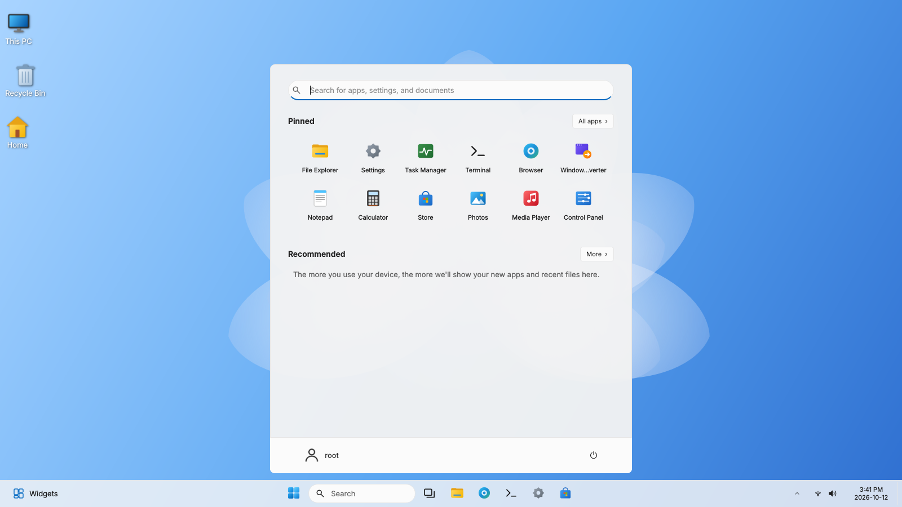
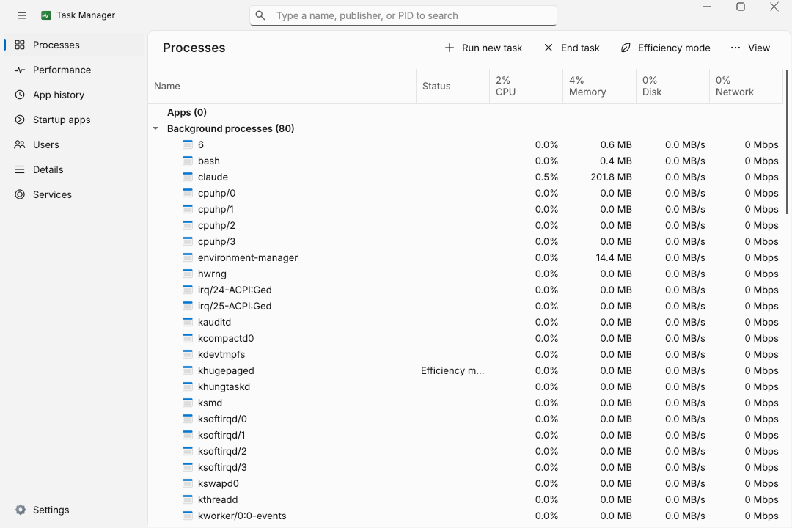
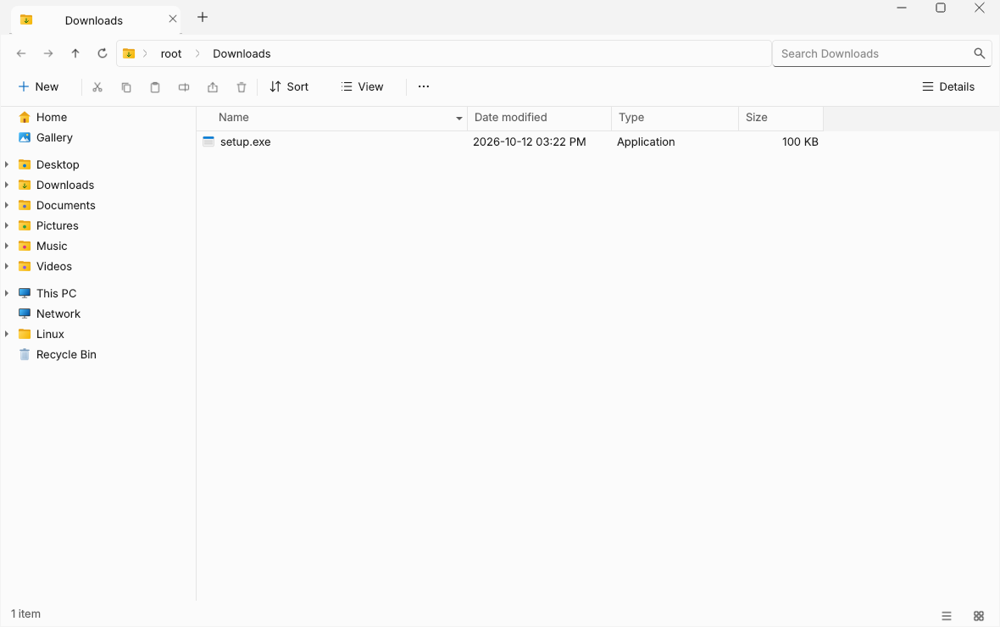
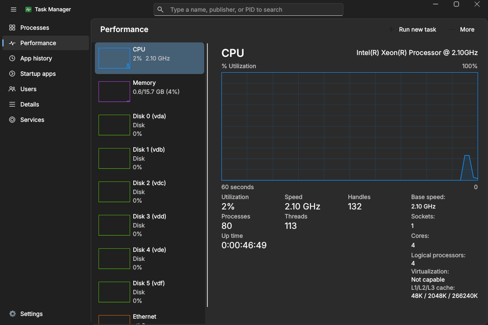
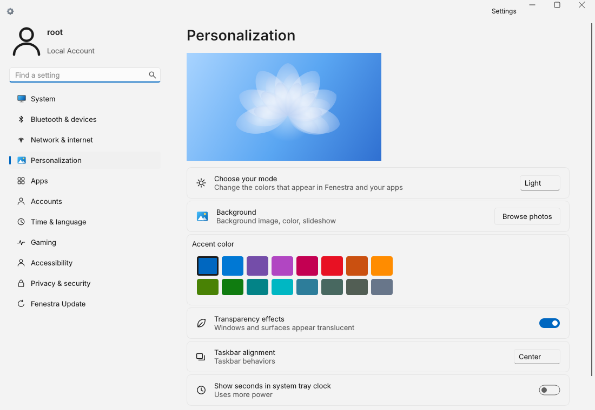
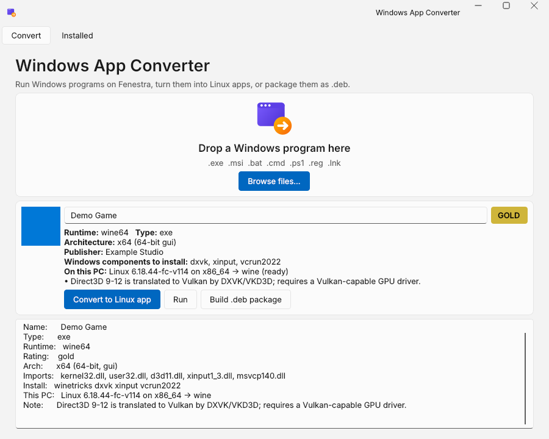
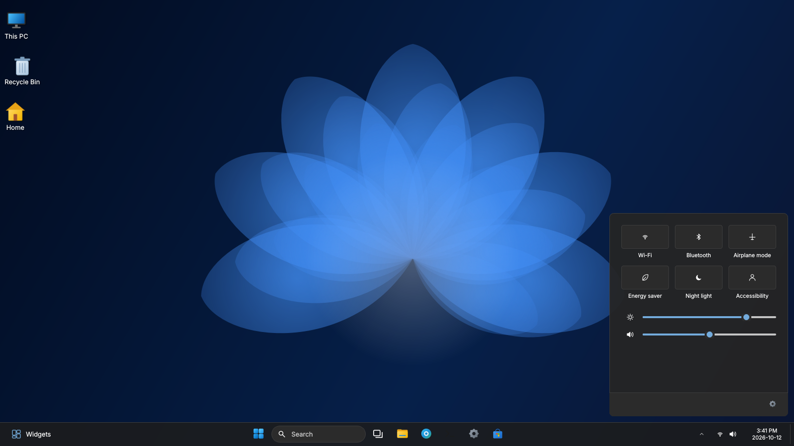
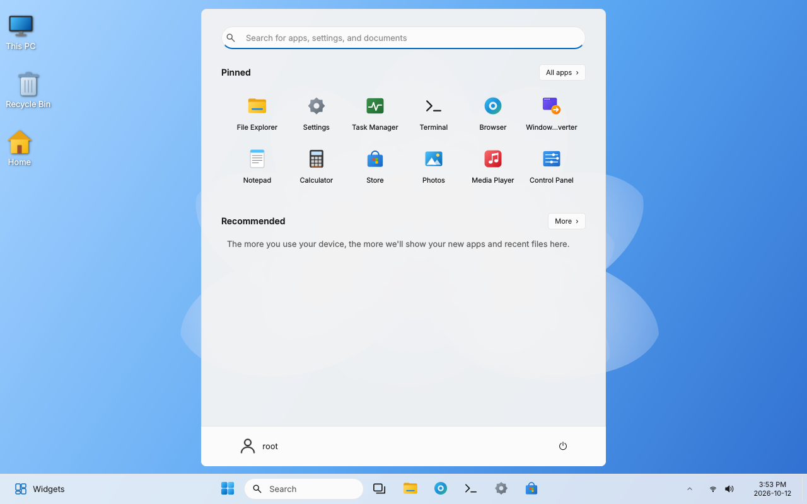
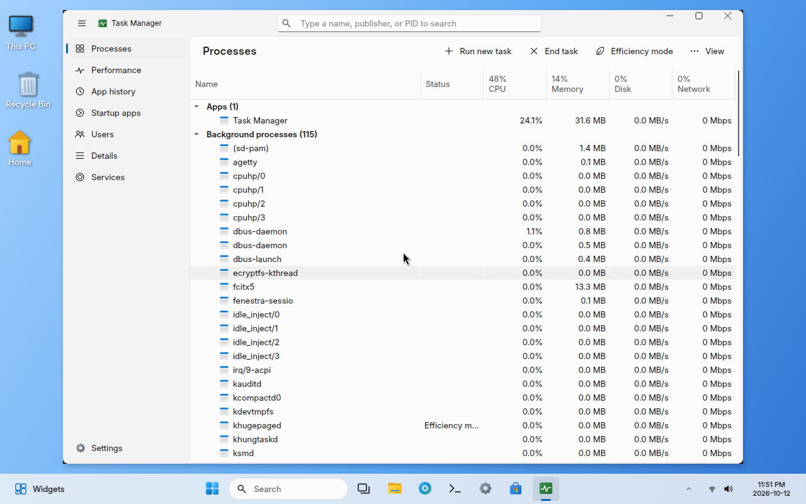

# Fenestra OS

**Windows 11처럼 보이고 동작하는 리눅스 배포판** — Debian 12 기반, Windows 프로그램(.exe/.msi/.bat) 실행·변환 기능 내장.

> *Fenestra*는 라틴어로 "창(window)"이라는 뜻입니다.
> A Debian-based Linux distribution with a Windows 11 style desktop, Task Manager, File Explorer,
> Settings and a built-in Windows app converter (Wine front-end, `.bat → bash` translator, `.exe → .deb` packager).



| 작업 관리자 | 파일 탐색기 |
|---|---|
|  |  |
| **성능 탭 (다크 모드)** | **설정 › 개인 설정** |
|  |  |
| **Windows 앱 변환기** | **빠른 설정 (다크 모드)** |
|  |  |

---

## WindowsFX(Windowsfx / Wubuntu)와 무엇이 다른가

WindowsFX는 우분투에 KDE Plasma 데스크톱을 깔고 Windows 11처럼 보이도록 **테마를 입힌** 배포판입니다
(PC용 x86-64 전용이고, 일부 기능은 유료 라이선스로 제공됩니다). Fenestra는 겉모습이 아니라 **동작**을 목표로 합니다.

| | WindowsFX | **Fenestra OS** |
|---|---|---|
| 데스크톱 | KDE Plasma에 Windows 테마를 입힘 | Windows 11 셸을 **처음부터 직접 구현**(작업 표시줄·시작 메뉴·빠른 설정·알림 센터) |
| 작업 관리자 / 탐색기 / 설정 | KDE 앱(System Monitor, Dolphin, System Settings)에 테마 | 메뉴 구성, 단축키, 상황에 맞는 메뉴까지 **Windows 11 앱과 같게 새로 만듦** |
| .exe 실행 | Wine을 기본 설정으로 실행 | exe를 **분석해서**(아키텍처, DLL, .NET, 설치 프로그램 종류) 필요한 런타임을 자동 설치하고 앱마다 **독립된 Wine 환경**을 만듦, 실행 불가능한 경우(드라이버/안티치트)는 이유를 알려 줌 |
| exe → 리눅스 앱 | 없음 | 시작 메뉴 항목 + 아이콘이 있는 앱으로 변환, 포터블 exe를 **.deb 패키지**로 변환 |
| exe → macOS 앱 | 없음 | 포터블 exe를 **더블클릭 가능한 .app 번들**로 변환(아이콘 포함) |
| .bat 배치 파일 | Wine의 cmd.exe | **Bash 스크립트로 변환**(`bat2sh`), 변환하지 못한 명령만 cmd.exe로 처리 |
| ARM / Apple Silicon | 지원 안 함 | **ARM64 ISO**, Apple Silicon 감지, x86 exe를 **Hangover(FEX)·muvm·box64·Rosetta 2**로 실행 |
| macOS에서 실행 | 불가 | 작업 관리자·탐색기·설정·변환기를 **macOS 앱으로 그대로 실행**, 데스크톱 전체를 창 모드로 실행 |
| 소스 / 가격 | 일부 기능 유료 라이선스 | **MIT 오픈소스, 무료**, 테스트·CI 포함 |
| 그래픽 리소스 | — | 아이콘·배경 화면을 전부 직접 그림(Microsoft 로고·아이콘·글꼴 미사용) |

---

## 맥북(M1/M2/M3, MacBook Air M1 포함)에서 실행하기

용도에 맞는 방법을 고르면 됩니다. `fenestra-compat host`를 실행하면 지금 컴퓨터에서 x86/x64/ARM64 exe를
각각 어떤 방식으로 실행하는지 알려 줍니다.

| 방법 | 이런 경우에 | 리눅스 데스크톱 | .exe 실행 방식 |
|---|---|---|---|
| **A. macOS 앱으로 설치** | macOS를 그대로 쓰면서 Fenestra 앱과 exe 변환만 쓰고 싶을 때 | 창 모드 | Wine + **Rosetta 2** (네이티브 대비 약 70~80%) |
| **B. UTM 가상 머신 (ARM64 ISO)** | macOS 안에서 Fenestra OS 전체를 써 보고 싶을 때 | ✅ 전체 | **Hangover(Wine + FEX)** |
| **C. Asahi Linux (직접 설치)** | 맥북을 Fenestra 전용으로 쓰거나 최고 성능이 필요할 때 | ✅ 전체 | Wine + **muvm + FEX** (Asahi의 16K 페이지 커널 대응) |

### A. macOS 앱으로 설치 (가장 간단)

```bash
# Homebrew가 없으면 https://brew.sh 에서 먼저 설치
git clone https://github.com/sms2620525-lgtm/os.git fenestra && cd fenestra
./scripts/macos/install.sh --wine      # --wine: Rosetta 2 + Wine까지 설치해 .exe 실행 가능
```

`~/Applications`에 **Fenestra**(데스크톱 전체 창 모드), **Fenestra Task Manager**, **Fenestra File Explorer**,
**Fenestra Settings**, **Windows App Converter**가 생깁니다. 변환기에 .exe를 끌어다 놓으면 실행하거나
**macOS 앱(.app)으로 변환**할 수 있습니다. CLI로는 `fenestra-compat package app.exe --format app`입니다.



### B. UTM 가상 머신

1. [UTM](https://mac.getutm.app) 설치 → **Create a New Virtual Machine → Virtualize → Linux**
2. `fenestra-os-arm64.iso` 선택(GitHub Actions **Build ISO**의 arm64 아티팩트, 또는 ARM 리눅스에서
   `cd distro && sudo ./build.sh arm64`)
3. 메모리 4GB 이상, CPU 4코어, 디스크 32GB 이상 → 부팅 → 라이브 세션에서 바로 사용, 바탕 화면의
   **Install Fenestra OS**로 VM 디스크에 설치
4. 화면 크기 자동 조절과 클립보드 공유는 포함된 `spice-vdagent`가 처리합니다(Parallels/VMware Fusion도 동작).

### C. Asahi Linux (맥북에 직접 설치)

```bash
# macOS 터미널에서 Asahi 설치 (Fedora Asahi Remix 선택, 디스크 공간 일부를 리눅스용으로 나눔)
curl https://alx.sh | sh
# 리눅스로 부팅한 뒤
git clone https://github.com/sms2620525-lgtm/os.git fenestra && cd fenestra
sudo ./scripts/install-asahi.sh        # 로그아웃 → "Fenestra" 세션 선택
```

> M1 Air에서 키보드, 트랙패드, Wi‑Fi, 디스플레이, GPU 가속(Asahi Mesa), 사운드는 Asahi에서 지원됩니다.
> 지원 현황은 Asahi Linux 공식 문서를 확인하세요.


---

## 구성 요소

| 구성 요소 | 설명 |
|---|---|
| **셸** (`fenestra-shell`) | 가운데 정렬 작업 표시줄(시작·검색·작업 보기·고정/실행 중 앱, 실행 표시 점/활성 막대), 시작 메뉴(고정됨, 추천, 모든 앱, 앱·설정·파일·웹 검색, 전원 메뉴), 빠른 설정(Wi‑Fi, 블루투스, 비행기 모드, 절전, 야간 조명, 밝기/볼륨 슬라이더), 알림 센터 + 달력, 토스트 알림(`org.freedesktop.Notifications` 데몬), 위젯 보드, 작업 보기, 실행(Win+R) 대화 상자, 바탕 화면 아이콘(내 PC, 휴지통) |
| **작업 관리자** (`fenestra-taskmgr`) | Windows 11 22H2 레이아웃: 프로세스(앱/백그라운드 그룹, 히트맵, 효율 모드), 성능(CPU/메모리/디스크/네트워크/GPU 그래프), 앱 기록, 시작 앱(사용/사용 안 함), 사용자, 세부 정보(우선 순위·선호도·일시 중단), 서비스(systemd 시작/중지/다시 시작), 새 작업 실행, Ctrl+Shift+Esc |
| **파일 탐색기** (`fenestra-explorer`) | 제목 표시줄 안의 탭, 이동 경로 주소 표시줄, 명령 모음(새로 만들기·잘라내기·복사·붙여넣기·이름 바꾸기·공유·삭제·정렬·보기), 탐색 창(홈, 갤러리, 고정 폴더, 내 PC, 드라이브, 휴지통), 홈/내 PC 페이지, 자세히/아이콘/목록/타일 보기, 세부 정보 창(이미지·텍스트 미리 보기), Windows 11 스타일 상황에 맞는 메뉴, 진행률 대화 상자 복사/이동, 휴지통(freedesktop 규격), ZIP 압축/압축 풀기, 속성, 검색, Windows와 같은 단축키 |
| **설정** (`fenestra-settings`) | 시스템(디스플레이, 소리, 전원, 저장소, 정보), 블루투스 및 장치, 네트워크 및 인터넷, 개인 설정(라이트/다크, 강조색 16종, 배경, 투명 효과, 작업 표시줄 정렬), 앱, 계정, 시간 및 언어(한국어 포함), 게임, 접근성, 개인 정보 및 보안(방화벽), 업데이트 |
| **Windows 앱 변환기** (`fenestra-compat`) | 아래 설명 참조 |
| **창 관리** | Openbox + Windows 11 단축키 + Fluent 스타일 창 테마, picom 컴포지터(둥근 모서리 8px, 그림자, 아크릴 블러) |
| **배포판** | live-build로 만드는 부팅/설치 가능한 ISO — **amd64(PC)와 arm64(Apple Silicon VM, ARM PC)** (Calamares 설치 프로그램, LightDM 로그인, 한글 입력기 fcitx5-hangul, Noto CJK 폰트, Wine 64/32비트 또는 Hangover) |
| **창 모드** | `fenestra-shell --windowed`: 데스크톱 전체를 창 하나로 실행 (macOS, GNOME/KDE 등 다른 데스크톱에서) |

### 단축키

| 키 | 동작 | 키 | 동작 |
|---|---|---|---|
| `Win` | 시작 메뉴 | `Win+E` | 파일 탐색기 |
| `Win+S` | 검색 | `Win+I` | 설정 |
| `Win+A` | 빠른 설정 | `Win+N` | 알림 센터 |
| `Win+R` | 실행 | `Win+D` | 바탕 화면 보기 |
| `Win+Tab` | 작업 보기 | `Win+W` | 위젯 |
| `Win+←/→/↑/↓` | 창 스냅/최대화/최소화 | `Win+L` | 잠금 |
| `Ctrl+Shift+Esc` | 작업 관리자 | `Alt+Tab` / `Alt+F4` | 창 전환 / 닫기 |
| `Win+Shift+S` | 캡처 도구 | `PrtSc` | 전체 화면 캡처 |

---

## Windows 프로그램 실행 및 변환

`.exe`는 Windows용 기계어와 Windows API(DLL)를 사용하므로 그대로 "리눅스용 바이너리로 재컴파일"할 수는 없습니다.
Fenestra는 대신 **Wine**(Windows API를 리눅스에서 구현한 호환 계층)을 기반으로, 프로그램을 분석해 필요한 구성 요소를
자동으로 설치하고 **일반 리눅스 앱처럼 설치·실행·패키징**되도록 변환합니다.

```
fenestra-compat analyze  setup.exe          # 실행 방식 분석 (아키텍처, DLL, 설치 프로그램 종류, 호환성 등급)
fenestra-compat run      program.exe        # 바로 실행 (.exe .msi .bat .cmd .ps1 .reg .lnk .com)
fenestra-compat convert  setup.exe          # 리눅스 앱으로 설치: 전용 Wine prefix + 시작 메뉴 항목 + 아이콘
fenestra-compat package  app.exe -o out/    # 포터블 .exe → .deb (리눅스) / .app (macOS, --format app)
fenestra-compat host                         # 이 컴퓨터의 실행 방식 (Wine / Hangover / FEX / box64 / Rosetta 2)
sudo fenestra-compat setup-arm               # ARM64 Debian/Ubuntu에 Hangover 설치
fenestra-compat bat2sh   build.bat -o build.sh   # Windows 배치 파일 → Bash 스크립트
fenestra-compat icon     app.exe icon.png   # .exe 아이콘 추출
fenestra-compat gui                          # 그래픽 변환기 (탐색기에서 .exe 우클릭 → "Convert to Linux app…")
```

무엇을 하는지:

1. **PE 분석기** (`fenestra/compat/pe.py`, 순수 파이썬): x86/x64/ARM64, GUI/콘솔, 가져오는 DLL(지연 로드 포함),
   .NET(CLR) 여부, 버전 정보(제품명/회사명/버전), 내장 아이콘, 매니페스트(관리자 권한), 설치 프로그램 종류
   (NSIS, Inno Setup, InstallShield, WiX, 7‑Zip SFX, Squirrel/Electron)를 읽습니다.
2. **호환성 분석** (`analyzer.py`): DLL 목록으로 필요한 구성 요소를 판단합니다
   (예: `msvcp140.dll` → `vcrun2022`, `d3dx9_43.dll` → `d3dx9`, `d3d11.dll` → `dxvk`, `d3d12.dll` → `vkd3d`,
   `xinput1_3.dll` → `xinput`, `.NET` → Wine Mono/`dotnet48`). 커널 드라이버·커널 안티치트처럼 원리상 불가능한 것은
   `borked`로 표시하고 이유를 설명합니다.
3. **변환** (`runner.py`): 앱마다 독립된 Wine prefix(`~/.local/share/fenestra/prefixes/<앱>`)를 만들고 winetricks로
   구성 요소를 설치한 뒤, 설치 프로그램을 실행해 설치된 주 실행 파일을 찾아 `~/.local/bin/<앱>` 실행 스크립트와
   아이콘이 있는 `.desktop` 항목을 만듭니다 → 시작 메뉴/작업 표시줄에서 일반 앱처럼 실행됩니다.
4. **.deb 패키저**: `dpkg-deb` 없이 순수 파이썬으로 `ar`/`tar` 형식의 .deb를 만듭니다. `/opt/fenestra-apps/<앱>`에
   프로그램을, `/usr/bin`에 실행 스크립트를, 아이콘과 메뉴 항목을 포함하며 `wine`에 의존합니다.
5. **bat2sh**: `echo/set/set /a/set /p/if/else/for(/l /f /d)/goto/call :label/exit /b/pushd/copy/del/dir/...`,
   `%VAR%`, `!VAR!`, `%~dp0`, `%~nx1`, `%VAR:~1,3%`, `%VAR:a=b%`, `&`/`&&`/`||`/`>nul`, `C:\` 경로를 Bash로 변환합니다.
   변환할 수 없는 명령은 Wine의 `cmd.exe`로 넘겨 스크립트가 계속 동작하게 합니다.
6. **아키텍처별 실행 엔진** (`hosts.py`): PC에서는 Wine, ARM64 리눅스에서는 Hangover(Wine+FEX) → muvm+FEX(Asahi)
   → box64 순서로, Apple Silicon macOS에서는 Wine을 Rosetta 2로 실행합니다. ARM64용 Windows exe는 에뮬레이션 없이
   네이티브로 실행합니다.
7. **더블클릭 실행**: binfmt_misc 등록(`./setup.exe` 직접 실행) 및 MIME 연결로 탐색기에서 .exe를 바로 엽니다.

---

## 설치

### 1) 기존 Debian 12 / Ubuntu 22.04+ 에 설치

```bash
git clone https://github.com/sms2620525-lgtm/os.git fenestra && cd fenestra
sudo ./scripts/install.sh
# 로그아웃 → 로그인 화면에서 "Fenestra" 세션 선택
```

### 2) 부팅 가능한 ISO 만들기

**Ubuntu 24.04 기반 (live-build 없이, 가장 간단):**

```bash
sudo apt install debootstrap squashfs-tools xorriso grub-pc-bin grub-efi-amd64-bin mtools dosfstools
sudo ./distro/ubuntu/build-iso.sh /var/tmp/fenestra-iso   # → fenestra-os-<버전>-amd64.iso (BIOS/UEFI)
```

이 빌드는 QEMU 가상 머신에서 부팅까지 확인했습니다(라이브 세션으로 바로 Fenestra 데스크톱 진입, Win 키 시작 메뉴,
Ctrl+Shift+Esc 작업 관리자 동작). GitHub에서 **Actions → Build ISO → Run workflow**를 누르면(워크플로 파일은 기본 브랜치에 있어야 보입니다) 같은 ISO가
아티팩트로 만들어지고, `v0.1.0` 같은 태그를 푸시하면 Releases에 ISO가 첨부됩니다.



**Debian 12 기반 (live-build, amd64/arm64, Calamares 설치 프로그램 포함):**

```bash
sudo apt install live-build
cd fenestra/distro && sudo ./build.sh        # → fenestra-os-amd64.hybrid.iso (PC)
sudo ./build.sh arm64                         # → fenestra-os-arm64.hybrid.iso (Apple Silicon VM, ARM 기기에서 빌드)
```

ISO를 USB에 기록(`dd`, Rufus, balenaEtcher)하거나 VirtualBox/QEMU에서 부팅하면 라이브 세션으로 바로 Fenestra가
실행되고, 바탕 화면의 **Install Fenestra OS**(Calamares)로 디스크에 설치할 수 있습니다.
GitHub Actions의 **Build ISO** 워크플로를 수동 실행해도 ISO가 아티팩트로 만들어집니다.

### 3) 설치하지 않고 개발 모드로 실행

```bash
sudo apt install python3-pyqt6 python3-psutil python3-xlib     # 또는: pip install PyQt6 psutil python-xlib
python3 -m fenestra.taskmgr       # 작업 관리자
python3 -m fenestra.explorer      # 파일 탐색기
python3 -m fenestra.settings      # 설정
python3 -m fenestra.compat gui    # Windows 앱 변환기
python3 -m fenestra.shell         # 셸 (X11 세션에서)
make test                         # 테스트
```

---

## 프로젝트 구조

```
fenestra/
  common/     Fluent 테마(라이트/다크, 강조색), 벡터 아이콘, 앱 레지스트리(.desktop), 프레임 없는 창, EWMH(X11)
  shell/      작업 표시줄, 시작 메뉴, 빠른 설정, 알림 센터/토스트, 위젯, 작업 보기, 바탕 화면, 배경 화면 생성기
  taskmgr/    작업 관리자 (psutil, /proc, systemd)
  explorer/   파일 탐색기 + 파일 작업(복사/이동/휴지통/압축)
  settings/   설정 앱
  compat/     PE 분석기, 호환성 분석, 아키텍처별 실행 엔진(hosts), Wine 실행/변환, .deb/.app 패키저, bat2sh, CLI/GUI
  common/platform.py  리눅스 x86 / ARM64 / Apple Silicon / macOS 차이 처리
bin/          실행 스크립트 (fenestra-session, fenestra-shell, ...)
data/         Openbox 설정/테마, picom, xsession, .desktop, binfmt, LightDM, 기본 사용자 설정
distro/       live-build ISO 구성 (패키지 목록, 훅)
scripts/      install.sh (Debian/Ubuntu), install-asahi.sh (M1 맥북 Asahi), macos/install.sh (macOS), Fluent 테마
tests/        pytest (합성 PE 파일 생성기 포함)
```

## 한계 (정직하게)

- Windows 자체가 아니라 **리눅스 위의 Windows 11 스타일 데스크톱**입니다. 모양과 사용법은 최대한 같게 만들었지만
  Microsoft의 코드·로고·아이콘·글꼴은 사용하지 않습니다(모든 아이콘과 배경 화면은 직접 그린 원본입니다).
- Windows 프로그램 호환성은 Wine의 수준을 따릅니다. 대부분의 일반 프로그램과 많은 게임은 잘 동작하지만,
  커널 드라이버, 커널 수준 안티치트, 일부 최신 DRM, MSIX(Microsoft Store) 패키지는 동작하지 않습니다.
- 셸은 X11(Openbox) 기반입니다. Wayland는 아직 지원하지 않습니다(창 모드로는 실행 가능).
- ARM(Apple Silicon)에서 x86 exe는 에뮬레이션/번역되므로 PC보다 느립니다. 가벼운 프로그램은 쾌적하지만
  최신 3D 게임은 기대하기 어렵습니다. macOS 네이티브 모드에서는 작업 관리자의 서비스 탭이 launchd 작업을
  보여 주고, 리눅스 전용 설정 항목은 동작하지 않습니다.
- macOS 설치 스크립트, Asahi 스크립트, ARM64 ISO 빌드는 이 저장소의 CI(리눅스 x86)에서 직접 실행해 보지
  못했습니다. 실행 엔진 선택 로직은 각 환경을 흉내 낸 단위 테스트로 검증했습니다.

## 라이선스

MIT — [LICENSE](LICENSE) 참조. ISO에 포함되는 Debian 패키지, Wine, Fluent GTK/아이콘 테마는 각자의 라이선스를 따릅니다.
Windows는 Microsoft Corporation의 상표이며, 이 프로젝트는 Microsoft와 관련이 없습니다.
